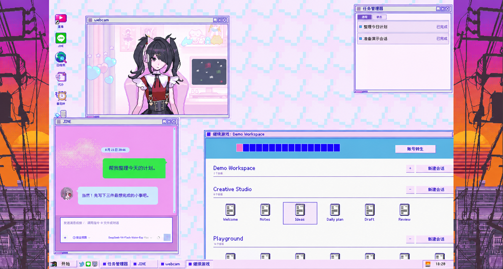

# Internet Angel Desktop · 超绝网络天使桌面

npm パッケージ名: `@smalltailqwq/dsh-client-ui-skin-internet-angel-desktop`

[简体中文](README.md) | [English](README.en.md) | 日本語

**DSH Web を windose20 のデスクトップに。**

『NEEDY GIRL OVERDOSE』に着想を得た、非公式・非商用のファンメイドスキンです。
JINE で会話し、タスクマネージャーで処理の進行を確認し、POKETTER で結果を読みながら、デスクトップのウィンドウを行き来して作業を続けられます。



> **開発中・テスト段階**：機能やレイアウトは調整中です。デバイス、ブラウザー、表示倍率、ホストのバージョンによっては問題が発生する場合があります。

## このデスクトップでできること

- ドラッグ移動・サイズ変更・最小化ができるウィンドウと、スタートメニュー、タスクバー、セーブへのアクセス。
- JINE の会話、POKETTER の結果表示、タスクマネージャーで、長時間のタスクもそれぞれの場所で確認。
- webcam のキャラクター表示、ToDo、ポモドーロタイマー、中国語・英語の UI。
- スキンマネージャーからフォント、キャラクター、音声を調整可能。BGM と SE は初期状態ではオフです。音を楽しみたい場合は音量を上げてください。
- いろいろなネタが入り混じった隠し要素。

## インストールとスキンマネージャー

動作する DSH Web 環境が必要です。スキンの切り替えや、このスキンのカスタマイズには、
[skin-manager](https://github.com/Small-tailqwq/dsh-deep-whale/tree/main/skin-manager)
の併用をおすすめします。

ターミナルで次のコマンドを順番に実行してください（`web` は使用しているプロファイル名に置き換えてください）。

```powershell
dsh plugin --profile web add 'github:Small-tailqwq/dsh-deep-whale#path:/skin-manager'
dsh plugin --profile web add 'github:Small-tailqwq/dsh-internet-angel-desktop'
```

インストール後に DSH Web を再起動し、**設定 → スキン管理**からこのスキンを選択してください。複数のスキンが同時に有効になっている場合、
マネージャーがいったん公式の標準画面に戻すことがあります。その場合は使いたいスキンを手動で選び直してください。このリポジトリと推奨スキンマネージャーはどちらも公開されているため、上記の GitHub インストールコマンドをそのまま利用できます。

**これは DSH Web 用の UI スキンであり、単体で動作するゲームではありません。** ホストとの互換性に関する宣言は [skin.json](skin.json) を参照してください。
他のバージョン、すべてのデバイス、サードパーティ製プラグインとの互換性を一律に保証するものではありません。

現在の対応対象は DSH `0.2.0-rc.2` です。デスクトップとスタートメニューの Plugin Manager から、
標準のプラグイン一覧・詳細・設定をドラッグ・サイズ変更可能なウィンドウで開けます。最小化・終了で
会話に戻り、タスクバーから復元すると一覧を開きます。コントロールパネルは設定ポータルに追従し、
狭い幅では横スクロールできます。設定ナビゲーション、ドラッグ、ウィンドウ操作、フォーム編集と
会話の下書き保持を確認しました。インストール・有効化・設定保存・IME の組み立て入力は未検証です。

コントロールパネル、プラグイン管理と標準ツールは共通のピクセル調コントロールを使います。
ブラウザー（デスクトップとスタートメニュー）と端末（タスクマネージャー横のクイック起動）は、
右サイドバーを開かずにデスクトップのウィンドウ枠で浮動表示し、タスクバーから再フォーカスできます。
「配信」は公式チャンネルをブラウザーで開き、JINE タイトルバーの虫眼鏡はチャット検索ウィンドウを
開きます。「マイ コンピューター」は現在の会話のワークスペースを表示する XP 風エクスプローラーで、
ファイルはホストのプレビューで開き、「マイ ピクチャ」には JINE の画像が集まります。ツールは選択中の
会話に従い、無効なホスト機能は使用不可と表示します。Web profile ではブラウザーが既定で無効なため、
「配信」は新しいタブで開きます。

## フィードバックの対象範囲

**本プロジェクトでは、サードパーティ製プラグインとの互換性に関する問題報告は一切受け付けていません。**
この疑似デスクトップでは、多くのプラグインに個別の対応が必要です。起動ボタン、ポップアップ、レイアウトなどに、公式画面の構造をそのまま使うことはできません。
プラグインの起動ボタンが見つからない、プラグインのウィンドウが隠れる、他のプラグインとの併用で表示が崩れるといった問題は、本プロジェクトの対応範囲外です。
上記のスキンマネージャーは特定の連携用途のために推奨しており、プラグイン全般への互換性サポートを意味するものではありません。

スキン自体の問題については、報告を歓迎します。まず Agent に調査と情報整理を依頼し、その後、あなたの許可を得た Agent に
[issue を作成](https://github.com/Small-tailqwq/dsh-internet-angel-desktop/issues/new/choose)してもらうこともできます。
テンプレートに沿って、DSH とスキンのバージョン、OS、ブラウザー、表示倍率、再現手順、期待した結果と実際の結果、
機密情報や個人情報を除いたスクリーンショットまたはエラーログを記載してください。可能な限り、他の不要なプラグインを無効にしても再現することを確認し、既存の issue も検索してください。
アクセストークン、秘密鍵、チャット履歴の全文、個人のディレクトリパスを含むログはアップロードしないでください。

## 開発

```powershell
pnpm install
pnpm typecheck
pnpm build
pnpm build:manifest
```

ソースコードは `src/`、インストール用のビルド成果物は `lib/` にあります。元のアセットは `assets/source/` にあり、`assets/art.manifest.json` に登録されています。`pnpm build` はまずそれらを内容ハッシュ名で `assets/runtime/` にコピーし、JavaScript に埋め込まずスキンの node 側ルートから配信します。変更後はビルド成果物、ランタイムアセット、ビルドフィンガープリントを同期してください。
テストは `tests/` にあります。ビルドやユニットテストは、実機での表示・操作の確認に代わるものではありません。
スキン自体に関する再現可能な不具合報告や、小さな範囲の改善を歓迎します。

## 著作権と素材

本プロジェクトは原作ゲームの Web 移植ではありません。また、原作の権利者、DSH、関連する制作チームや販売元から、公式な許諾・協賛・推奨を受けたものでもありません。
プロジェクトのメンテナーが維持しているのはスキンの実装のみであり、含まれる第三者のゲーム素材、フォント、クライアント素材の権利を保有しているわけではありません。

現時点では、このリポジトリに一般的なオープンソースライセンスは付与されていません。**ソースコードを閲覧できることは、素材の再配布や商用利用の許可を意味しません。**
非商用利用をうたうことも、権利者の許諾に代わるものではありません。素材の帰属、出典の分類、未確認事項の詳細は、
[素材帰属レポート](assets/ATTRIBUTION.md)と[著作権に関する声明](NOTICE.md)をご覧ください。権利者の方は、該当する素材への対応について issue からメンテナーにご連絡いただけます。

## 謝辞

とある謎のフォーラムの `amechanll` さん、そして貴重なご意見やアイデアを寄せてくださった多くの兄弟姉妹の皆さんに感謝します。このデスクトップを一緒にもっと楽しいものにしてくれて、ありがとうございます。
